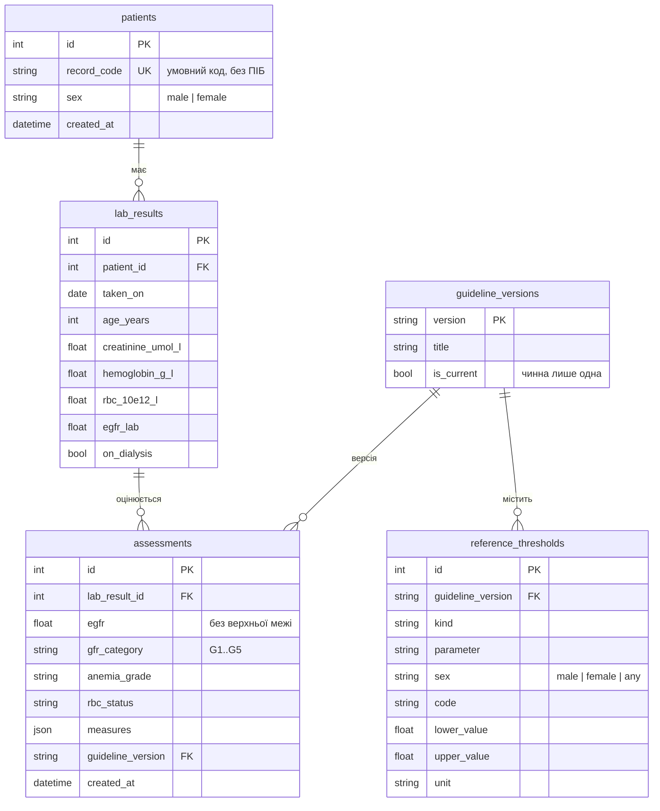

# Рівень даних

Відповідальний: Database Developer / QA. База даних — SQLite (сумісна з PostgreSQL),
доступ лише через репозиторії шару інфраструктури за портами з `backend/services/ports.py`.
База **не містить клінічної логіки**: розрахунки й категорії — у `backend/domain/`,
клінічні межі — як дані в `reference_thresholds`.

## Де лежать файли

Код рівня даних живе всередині `backend/`, бо він є шаром серверної частини:

```
backend/
├── services/ports.py              # порти й DTO (спільно з Backend Developer)
├── infrastructure/                # шар 4: зона Database Developer
│   ├── db.py                      # таблиці, обмеження, індекси, рушій, PRAGMA
│   ├── repositories.py            # реалізації портів (SQLAlchemy)
│   └── reference_seed.py          # початкові дані довідника
├── alembic.ini
├── migrations/
│   ├── env.py
│   └── versions/
│       ├── 0001_kidney.py         # інкремент 1: функція нирок
│       ├── 0002_anemia.py         # інкремент 2: анемія
│       └── 0003_history.py        # інкремент 3: історія, measures
├── scripts/backup_db.py           # резервна копія + integrity_check
└── tests/test_repositories.py     # інтеграційні тести на SQLite
```

## Логічна модель



| Таблиця | Що зберігає | Ключове рішення |
| --- | --- | --- |
| `patients` | умовний код картки, стать | без персональних даних |
| `lab_results` | один забір аналізів, вік на дату аналізу | лише одиниці системи; одиниця в назві колонки |
| `assessments` | результат оцінювання | окремо від аналізу: можна переоцінити, не втративши старий результат |
| `guideline_versions` | версії настанов | чинна лише одна (частковий унікальний індекс) |
| `reference_thresholds` | граничні й порогові значення | одна таблиця «вид — показник — стать — код — межі» |

## Відповідність коду і API

| Що | Backend / API | База даних |
| --- | --- | --- |
| Граничні значення | `domain/limits.py`, `GET /api/reference` | `reference_thresholds`, `kind = 'input_limit'` |
| Коди одиниць | `umol_l`, `g_l`, `10e12_l`, `ml_min_1_73m2` | колонка `unit` — ті самі коди |
| ШКФ від лабораторії | поле запиту й `indicator` = `egfr_lab` | `lab_results.egfr_lab`; у довіднику `parameter = 'egfr'` |
| Межі категорій G1–G5 | `GfrCategory(code, lower_bound)` | `kind = 'gfr_category'`, лише `lower_value` |
| Межі включні | `Limits.contains` | `lower_value <= x <= upper_value` |
| Версія настанов | `AssessmentResponse.guideline_version` | `assessments.guideline_version` → `guideline_versions` |
| Пацієнта немає | HTTP 404 | `UnknownPatientError` |

## Відкриті питання

- [ ] **Дата аналізу.** `lab_results.taken_on` обов'язкова, а в запиті
  `POST /api/assessments` такого поля немає. Пропозиція: додати необов'язкове
  `taken_on`, за замовчуванням — сьогоднішня дата.
- [ ] **Створення пацієнтів.** Немає маршруту для `patients` (`record_code`, `sex`).
  Пропозиція: `POST /api/patients` у наступному інкременті; поки що — тестові дані.
- [ ] **Стать двічі.** Стать приходить у запиті й зберігається в `patients`.
  Пропозиція: якщо `patient_id` вказано, сервер перевіряє збіг.
- [ ] **Вагітність.** Поле `pregnant` є в запиті, але не зберігається.
  Вирішити, чи потрібна колонка в `lab_results`.
- [ ] **Гемоглобін.** В API обов'язковий, у `lab_results.hemoglobin_g_l` — може бути NULL
  (для інкремента 1, де анемії ще немає). Після інкремента 2 зробити NOT NULL.
- [ ] **Назва показника ШКФ.** У довіднику `parameter = 'egfr'` для двох видів
  (`input_limit` і `gfr_category`), в API — `egfr_lab`. Репозиторій перетворює назву;
  як варіант — у довіднику для `input_limit` писати одразу `egfr_lab`.
