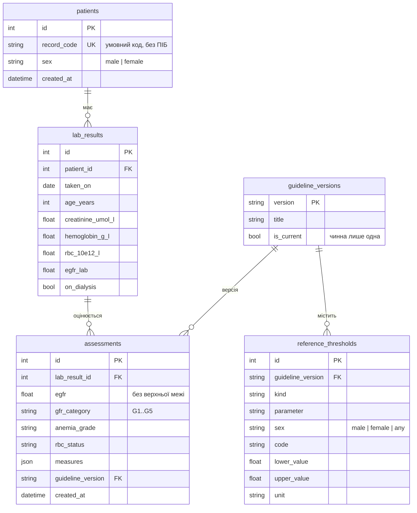

# Рівень даних

Відповідальний: Database Developer / QA. База даних — SQLite (сумісна з PostgreSQL),
доступ лише через репозиторії шару інфраструктури за портами з `backend/services/ports.py`.
База **не містить клінічної логіки**: розрахунки й категорії — у `backend/domain/`,
клінічні межі — як дані в `reference_thresholds`.

## Де лежать файли

Код рівня даних живе всередині `backend/`, бо він є шаром серверної частини.
Файли вже створені як **заготовки**: імпорти, класи, сигнатури функцій і `TODO`
з описом, що саме написати. Тіла функцій поки кидають `NotImplementedError`.

```
backend/
├── services/ports.py              # готово: порти, DTO і винятки (спільно з Backend)
├── infrastructure/
│   ├── db.py                      # TODO: колонки, CHECK, індекси, create_db_engine, PRAGMA
│   ├── repositories.py            # TODO: get_current, save, list_by_patient
│   ├── reference_seed.py          # TODO: reference_rows() — 24 рядки довідника
│   └── memory.py                  # тимчасова заміна БД (Backend), видалити після SQLite
├── alembic.ini                    # готово: налаштування Alembic
├── migrations/
│   ├── env.py                     # готово: підключає metadata з db.py
│   ├── script.py.mako             # готово: шаблон нових міграцій
│   └── versions/
│       ├── 0001_kidney.py         # TODO: таблиці інкремента 1 + довідник
│       ├── 0002_anemia.py         # TODO: колонки анемії
│       └── 0003_history.py        # TODO: індекс історії
├── scripts/backup_db.py           # TODO: backup_database, check_integrity
└── tests/test_repositories.py     # готово: 11 тестів, поки пропущені (skip)

database/
├── README.md                      # цей файл: модель, відповідність API, питання
└── schema.sql                     # цільова схема SQL (довідка за звітом, п. 2.4)
```

## Як почати писати код

1. `cd backend && pip install -r requirements.txt` (додано `sqlalchemy` і `alembic`).
2. У `tests/test_repositories.py` приберіть рядок `pytestmark = pytest.mark.skip(...)`.
3. Заповнюйте `TODO` у порядку: `db.py` → `reference_seed.py` → `repositories.py`,
   доки `pytest` не стане зеленим.
4. Перенесіть таблиці в міграцію `0001_kidney.py` і перевірте: `alembic upgrade head`.
5. Підключіть репозиторії в `backend/main.py`, функція `build_service`:
   `SqlAlchemyReferenceRepository(engine)` і `SqlAlchemyAssessmentRepository(engine)`
   замість `InMemory...`. Більше нічого в сервісі й API міняти не треба.

## Логічна модель



| Таблиця | Що зберігає | Ключове рішення |
| --- | --- | --- |
| `patients` | умовний код картки, стать | без персональних даних |
| `lab_results` | один забір аналізів, вік на дату аналізу | лише одиниці системи; одиниця в назві колонки |
| `assessments` | результат оцінювання | окремо від аналізу: можна переоцінити, не втративши старий результат |
| `guideline_versions` | версії настанов | чинна лише одна (частковий унікальний індекс) |
| `reference_thresholds` | граничні й порогові значення | одна таблиця «вид — показник — стать — код — межі» |

## Відповідність коду і API

| Що | Backend / API | База даних |
| --- | --- | --- |
| Граничні значення | `domain/limits.py`, `GET /api/reference` | `reference_thresholds`, `kind = 'input_limit'` |
| Коди одиниць | `umol_l`, `g_l`, `10e12_l`, `ml_min_1_73m2` | колонка `unit` — ті самі коди |
| ШКФ від лабораторії | поле запиту й `indicator` = `egfr_lab` | `lab_results.egfr_lab`; у довіднику `parameter = 'egfr'` (зіставляє сервіс) |
| Межі категорій G1–G5 | `GfrCategory(code, lower_bound)` | `kind = 'gfr_category'`, лише `lower_value` |
| Межі включні | `Limits.contains` | `lower_value <= x <= upper_value` |
| Версія настанов | `AssessmentResponse.guideline_version` | `assessments.guideline_version` → `guideline_versions` |
| Пацієнта немає | HTTP 404 | `UnknownPatientError` |

## Відкриті питання

- [x] **Дата аналізу.** У запит додано необов'язкове `taken_on`; якщо його немає,
  сервіс ставить сьогоднішню дату.
- [ ] **Створення пацієнтів.** Немає маршруту для `patients` (`record_code`, `sex`).
  Пропозиція: `POST /api/patients` у наступному інкременті; поки що — тестові дані.
- [ ] **Стать двічі.** Стать приходить у запиті й зберігається в `patients`.
  Пропозиція: якщо `patient_id` вказано, сервер перевіряє збіг.
- [ ] **Вагітність.** Поле `pregnant` є в запиті, але не зберігається.
  Вирішити, чи потрібна колонка в `lab_results`.
- [ ] **Гемоглобін.** В API обов'язковий, у `lab_results.hemoglobin_g_l` — може бути NULL
  (для інкремента 1, де анемії ще немає). Після інкремента 2 зробити NOT NULL.
- [x] **Назва показника ШКФ.** Сервіс працює з `parameter = 'egfr'`, як у довіднику,
  і сам зіставляє його з полем API `egfr_lab`. Репозиторію перетворювати не треба.
