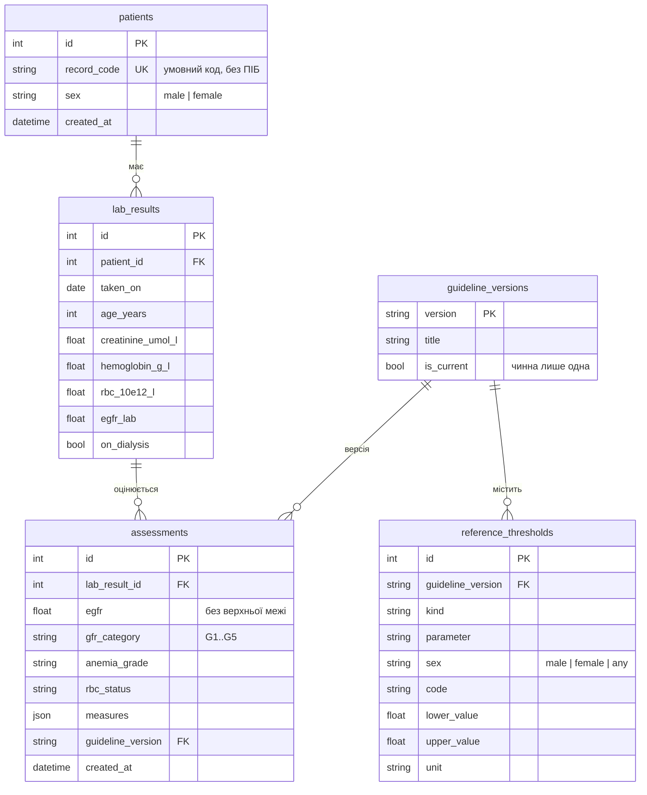

# Рівень даних

Відповідальний: Database Developer / QA. База даних — SQLite (сумісна з PostgreSQL),
доступ лише через репозиторії шару інфраструктури за портами з `backend/services/ports.py`.
База **не містить клінічної логіки**: розрахунки й категорії — у `backend/domain/`,
клінічні межі — як дані в `reference_thresholds`.

## Де лежать файли

Код рівня даних живе всередині `backend/`, бо він є шаром серверної частини.

```
backend/
├── services/ports.py              # порти, DTO і винятки (спільно з Backend)
├── infrastructure/
│   ├── db.py                      # таблиці, CHECK, індекси, create_db_engine, PRAGMA
│   ├── repositories.py            # SqlAlchemyReferenceRepository, SqlAlchemyAssessmentRepository
│   ├── reference_seed.py          # 24 рядки довідника (KDIGO-2024/WHO-2024)
│   └── memory.py                  # репозиторії в пам'яті — лише для тестів сервісу й API
├── alembic.ini                    # налаштування Alembic
├── migrations/
│   ├── env.py                     # metadata з db.py; адреса БД — DATABASE_URL або alembic.ini
│   ├── script.py.mako             # шаблон нових міграцій
│   └── versions/
│       ├── 0001_kidney.py         # таблиці інкремента 1 + довідник (14 рядків)
│       ├── 0002_anemia.py         # Hb, еритроцити, ступінь анемії + довідник (10 рядків)
│       └── 0003_history.py        # індекс історії
├── scripts/backup_db.py           # резервна копія + PRAGMA integrity_check
└── tests/
    ├── conftest.py                # тимчасова БД, створена міграціями, для всього прогону
    ├── test_repositories.py       # репозиторії, довідник, обмеження схеми, резервна копія
    └── test_migrations.py         # міграції = схема db.py; API зберігає історію в SQLite

database/
├── README.md                      # цей файл: модель, відповідність API, питання
└── schema.sql                     # цільова схема SQL (довідка за звітом, п. 2.4)
```

`main.py` (функція `build_service`) уже підключає SQLite-репозиторії замість репозиторіїв у пам'яті.

## Як запустити

```bash
cd backend
pip install -r requirements.txt
alembic upgrade head          # створює kidney.db (або БД з DATABASE_URL)
uvicorn main:app --reload     # сервер працює з цією ж БД
pytest                        # тести не чіпають kidney.db: їм потрібна тимчасова БД
python scripts/backup_db.py kidney.db backups/kidney-2026-11-13.db
```

Якщо сервер запустити без `alembic upgrade head`, оцінювання й довідник відповідають 503 з підказкою
створити схему. Пацієнтів поки додають вручну (маршруту ще немає), наприклад:
`INSERT INTO patients (record_code, sex) VALUES ('P-0001', 'female');`

## Логічна модель



| Таблиця | Що зберігає | Ключове рішення |
| --- | --- | --- |
| `patients` | умовний код картки, стать | без персональних даних |
| `lab_results` | один забір аналізів, вік на дату аналізу | лише одиниці системи; одиниця в назві колонки |
| `assessments` | результат оцінювання | окремо від аналізу: можна переоцінити, не втративши старий результат |
| `guideline_versions` | версії настанов | чинна лише одна (частковий унікальний індекс) |
| `reference_thresholds` | граничні й порогові значення | одна таблиця «вид — показник — стать — код — межі» |

## Відповідність коду і API

| Що | Backend / API | База даних |
| --- | --- | --- |
| Граничні значення | `domain/limits.py`, `GET /api/reference` | `reference_thresholds`, `kind = 'input_limit'` |
| Коди одиниць | `umol_l`, `g_l`, `10e12_l`, `ml_min_1_73m2` | колонка `unit` — ті самі коди |
| ШКФ від лабораторії | поле запиту й `indicator` = `egfr_lab` | `lab_results.egfr_lab`; у довіднику `parameter = 'egfr'` (зіставляє сервіс) |
| Межі категорій G1–G5 | `GfrCategory(code, lower_bound)` | `kind = 'gfr_category'`, лише `lower_value` |
| Межі включні | `Limits.contains` | `lower_value <= x <= upper_value` |
| Версія настанов | `AssessmentResponse.guideline_version` | `assessments.guideline_version` → `guideline_versions` |
| Пацієнта немає | HTTP 404 | `UnknownPatientError` |
| Порушено обмеження БД | HTTP 409 | `DataIntegrityError` |
| Схеми немає / довідник неповний | HTTP 503 | `ReferenceDataError` |

## Відкриті питання

- [x] **Дата аналізу.** У запит додано необов'язкове `taken_on`; якщо його немає,
  сервіс ставить сьогоднішню дату.
- [ ] **Створення пацієнтів.** Немає маршруту для `patients` (`record_code`, `sex`).
  Пропозиція: `POST /api/patients` у наступному інкременті; поки що — тестові дані.
- [ ] **Стать двічі.** Стать приходить у запиті й зберігається в `patients`.
  Пропозиція: якщо `patient_id` вказано, сервер перевіряє збіг.
- [ ] **Вагітність.** Поле `pregnant` є в запиті, але не зберігається.
  Пропозиція Database Developer: зберігати, бо від нього залежить, чи підходять пороги
  Hb ВООЗ 2024 (`anemia_thresholds_apply`), — інакше старий результат неможливо
  пояснити. Потрібно: поле `LabInput.pregnant` (Backend) і колонка
  `lab_results.pregnant BOOLEAN NOT NULL DEFAULT false` окремою міграцією 0004.
- [x] **Гемоглобін.** `lab_results.hemoglobin_g_l` лишається NULL-допустимою: аналізи
  інкремента 1 законно не мають Hb, а NOT NULL або зламав би міграцію на старих даних,
  або змусив би вигадувати значення. Обов'язковість для нових аналізів перевіряє API.
- [x] **Назва показника ШКФ.** Сервіс працює з `parameter = 'egfr'`, як у довіднику,
  і сам зіставляє його з полем API `egfr_lab`. Репозиторію перетворювати не треба.
